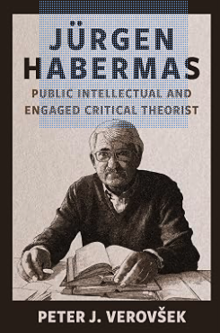

*Vanuit deze opvatting zouden filosofen die zich in het publieke debat mengen, ‘zichzelf moeten beschouwen als vertalers die abstracte kennis en ideeën omzetten in concretere bewoordingen’. Daarmee vervullen zij de rol van ‘deskundige gespreksleiders in het voortdurende besluitvormingsproces dat culturele vernieuwing vormt’*.\
 - Peter J. Verovšek

 

Ik heb zo’n rijtje favoriete filosofen waar ik graag bij tijd en wijle iets van of over lees. Dat ‘vriendengroepje’ bestaat uit John Dewey, Hannah Arendt, Richard Bernstein en Jürgen Habermas, filosofen die pendelen tussen het denken over en de moderne samenleving zelf. Dit jaar overleed van dit groepje ook Habermas (1929-2026). Over zijn filosofisch werk is het nodige geschreven. Er zat ook nog een andere kant aan Habermas. Habermas mengde zich namelijk sinds de jaren vijftig van de twintigste eeuw in allerlei politieke en maatschappelijke discussies die er in Duitsland speelden. Over dat deel, Habermas als publiek intellectueel, schreef Peter J. Verovšek recent *Jürgen Habermas: Public Intellectual and Engaged Critical.* Want Habermas was uiteindelijk niet alleen dé filosoof van de Frankfurter Schule en de kritische theorie, hij was ook de belangrijkste intellectueel in maatschappelijke en politieke debatten in Duitsland en Europa vanaf de Tweede Wereldoorlog tot en met heden. Over de rol van Habermas als publiek intellectueel  gaat dit boek. Zijn theorieën over communicatieve rationaliteit, democratie, rechtvaardigheid en de publieke sfeer worden in dit boek verweven met de verschillende politieke interventies die Habermas pleegde in de afgelopen zeventig jaar. Door het boek krijg je een aanvullend inzicht in Habermas’ werk. Tegelijk is het een heel mooi boek over de geschiedenis van Duitland (en Europa) na de Tweede Wereldoorlog.

Als vertegenwoordiger van de kritische theorie ontwikkelde Habermas een hele eigen opvatting over de maatschappelijke verantwoordelijkheid van filosofen en over de ingewikkelde relatie tussen theorie en praktijk. Politieke en maatschappelijke discussies waren voor hem democratische gesprekken. Daaraan wilde hij actief meedoen, zonder daarbij overigens als hoogleraar filosofie aanspraak te willen maken op een bevoorrechte positie. Hij zocht de publieke ruimten op die democratie heeft nodig voor burgers om met elkaar informatie uit te wisselen, argumenten te bespreken en om uiteindelijk oordelen te kunnen vormen over zaken die iedereen aangaan. Democratie is zoveel meer dan verkiezingen, parlementen en juridische procedures. Ze vraagt een actieve maatschappelijke houding en een levende publieke cultuur waarin burgers hun opvattingen kunnen vormen en ontwikkelen en waarin machthebbers ter verantwoording kunnen worden geroepen. Politiek is zoveel meer dan macht, traditie of economisch belang. Als je dat vindt komt het vermogen elkaar argumenten voor te leggen en tot wederzijds begrip te komen om de hoek kijken, niet om het altijd maar met elkaar eens te worden. Deze gedachten zit niet alleeen in Habermas’ theoretisch werk, die heeft hij ook in zijn publieke werk proberen waar te maken. Als geen ander leverde hij bijdragen aan de democratische meningsvorming met zijn essays, krantenartikelen, interviews en publieke discussies waaraan hij deelnam. Zijn wat afstandelijke filosofische theorie van de publieke sfeer krijgt gestalte in zijn deelname aan diezelfde publieke sfeer.

 

Habermas’ politieke betrokkenheid begint in het naoorlogse Duitsland. Habermas groeit op tijdens het naziregime en behoort tot een generatie die na 1945 geconfronteerd wordt met de morele en politieke verantwoordelijkheid van Duitsland. Dat naziverleden mag volgens hem niet worden gerelativeerd of verzwegen. Daarom reageert hij in 1953 als jonge filosoof ook zo fel op de grote Martin Heidegger, waar hijzelf zo door was beïnvloed, en die zijn vroegere betrokkenheid bij het nationaalsocialisme niet benoemde. Hoe kan, vraagt Habermas zich af, een democratische samenleving ontstaan wanneer haar burgers en intellectuele elites onvoldoende kritisch omgaan met hun eigen geschiedenis? In de jaren vijftig werkt Habermas eerst als journalist en publiceert hij regelmatig over filosofische en politieke kwesties. Zijn belangstelling voor de publieke meningsvorming is er al voordat hij zijn academische reputatie had opgebouwd.

Wanneer hij in 1956 bij het beroemde ‘Institut für Sozialforschung’ in Frankfurt gaat werken, krijgt deze betrokkenheid een theoretische verdieping. Onder invloed van Adorno en de kritische theorie begint hij systematisch na te denken over de verhouding tussen maatschappelijke machtsstructuren, democratie en publieke communicatie. Dit mondt uiteindelijk uit in zijn beroemde studie *Strukturwandel der Öffentlichkeit* (1962), waarin hij de historische ontwikkeling van de burgerlijke openbaarheid analyseert. In de jaren zestig raakt Habermas dan nauw betrokken bij de Duitse studentenbeweging. Hij ondersteunt veel van haar democratische en emancipatoire doelstellingen en bekritiseert de autoritaire elementen van de West-Duitse samenleving. Tegelijkertijd ontstaan er scherpe conflicten tussen Habermas en radicale studentenleiders. Habermas verzet zich tegen de directe actie, revolutionaire retoriek en confrontatie die de plaats lijken in te nemen van democratische discussie. Habermas heeft het over 'links fascisme' en dat brengt hem in conflict met een deel van de studentenbeweging. Habermas past ervoor zijn filosofische overtuigingen ondergeschikt te maken aan een politieke beweging ook al onderschrijft hij bepaalde doelstellingen. Democratische emancipatie mag nooit worden nagestreefd met middelen die de democratische discussie zelf ondermijnen.

Habermas trekt zich terug uit het directe politieke debat en concentreert zich op zijn theoretisch werk op het Max Planck-instituut. Hij werkt aan zijn ‘blauwe monster’, *Theorie des kommunikativen Handelns* (1981) waarin hij zijn opvattingen over rationaliteit, maatschappelijke integratie en de verhouding tussen systeem en leefwereld uitwerkt. Verovšek interpreteert deze periode niet als een afscheid van politieke betrokkenheid, maar als een fase waarin Habermas zijn theoretische grondslagen verdiept. Met deze kennis in de achterzak neemt Habermas vervolgens opnieuw een prominente plaats in het Duitse publieke debat in. Vooral zijn deelname aan de zogenoemde ‘Historikerstreit’ van 1986 maakt hem opnieuw tot een nationaal invloedrijke intellectueel. Daarin verzet Habermas zich tegen historici die volgens hem de bijzondere betekenis van de nationaal-socialistische misdaden relativeren door deze te vergelijken met andere historische vormen van massaal geweld. Deze discussie raakt voor hem aan de politieke identiteit van de Bondsrepubliek. Een democratisch Duitsland heeft volgens hem zijn legitimiteit niet te ontlenen aan nationale trots of historische continuïteit, maar aan de beginselen van de democratische rechtsstaat. Politieke verbondenheid behoort in zijn constitutioneel patriotisme gebaseerd te zijn op gedeelde democratische en constitutionele waarden, niet op etnische of culturele homogeniteit. Ook tijdens de Duitse hereniging in 1989–1990 verdedigt Habermas het belang van democratische legitimiteit en publieke discussie. Hij waarschuwt voor een herenigingsproces waarin nationale sentimenten en bestuurlijke besluitvorming de overhand hebben. Verovšek laat heel goed zien dat Habermas' publieke interventies steeds opnieuw voortomen uit zijn bezorgdheid over de democratische kwaliteit van politieke besluitvorming.

Na de val van de Berlijnse Muur in 1989 verschuift Habermas' aandacht geleidelijk van de Duitse nationale politiek naar de toekomst van Europa. Habermas beschouwt de Europese integratie als een historische mogelijkheid om nationale tegenstellingen te overstijgen en democratische samenwerking op internationaal niveau te ontwikkelen. Dat vraagt democratische legitimiteit van Europese instituties; economische integratie is volgens hem onvoldoende wanneer zij niet gepaard gaat met politieke democratisering en een Europese publieke sfeer. Volgens Verovšek wordt zijn politieke horizon internationaler, terwijl zijn fundamentele uitgangspunten grotendeels dezelfde blijven. De Europese schuldencrisis na 2008 vormt voor Habermas een nieuwe aanleiding om zich intensief in het politieke debat te mengen. Hij maakt zich zorgen over de toenemende invloed van financiële markten, technocratische instituties en economische belangen op democratische besluitvorming. Deze ontwikkeling sluit aan bij zijn oudere theorie over de ‘kolonisering van de leefwereld’, waarmee hij bedoelt dat economische en bureaucratische systemen steeds verder doordringen in maatschappelijke verhoudingen en persoonlijke relaties die eigenlijk door communicatie, solidariteit en onderling begrip zouden moeten worden gereguleerd. In de Europese politiek ziet Habermas dat economische noodzakelijkheden worden voorgesteld als onvermijdelijke feiten waarover burgers nauwelijks nog democratische zeggenschap hebben. Politieke beslissingen moeten volgens hem onderwerp blijven van openbare discussie en democratische verantwoording. Verovšek signaleert een opvallende ontwikkeling. Terwijl Habermas theoretisch vasthoudt aan het onderscheid tussen filosofische reflectie en politieke besluitvorming, treedt hij in de praktijk soms op als een uitgesproken pleitbezorger van Europese hervormingen. Hij verschijnt zelfs samen met politici op publieke bijeenkomsten en fungeert in zekere zin als informeel adviseur. Daarmee komt zijn eigen publieke optreden dichter bij de directe politieke beïnvloeding waarvoor hij eerder had gewaarschuwd.

 

De laatste jaren van Habermas’ leven neemt de productie van zijn politieke teksten af, terwijl rond 2020 nog een vuistdik en meerdelig eigenzinniuge geschiedenis van de filosofie schrijft. Habermas reageeert nog wel op de Russische invasie van Oekraïne van 24 februari 2022 en op het geweld van Israël in Gaza na de terroristische aanval van 7 oktober 2023. De Russische aanval is voor hem een schokkende ervaring, hij heeft begrip voor zijn eigen president wanneer die wat tijd neemt om zijn opties te onderzoeken en wijst er fijntjes op dat een oorlog tegen een nucleaire macht nooit gewonnen kan worden. Oekraïne mag de oorlog niet verliezen, vindt hij, maar er zal toch ook onderhandeld moeten worden met de oorlogsmisdadiger Poetin. Ten aanzien van Gaza ondertekent hij een algemene verklaring waarin solidariteit wordt uitgesproken voor Israël en de Joden in Duitsland. Het waren reacties voor de Duitse context en ondertussen is de wereld sterk veranderd, zoals hij zelf al in zijn nieuwe uitgave van *Structurele Transformatie* had geschreven. De teksten gaan tegenwoordig over landgrenzen heen, er is niet meer één leidend medium en het karakter van de hele deliberatie is veranderd. De wereld waarin hij zich bevindt is allang niet meer Habermas’ wereld. Verovšek vraagt zich aan het einde van het boek af of Habermas misschien niet een van de laatste publieke intellectuelen is geweest; een van de laatste gezaghebbende denkers die via kranten, tijdschriften en publieke lezingen langdurig invloed uitoefenen op nationale politieke discussies. Sociale media, digitale platforms, politieke polarisatie en de versnippering van het medialandschap hebben de voorwaarden voor publieke meningsvorming, waar hij expliciete ideeën over heeft, ingrijpend veranderd. De discussies rond de oorlog in Oekraïne en het conflict in Gaza laten zien hoe moeilijk het is geworden om complexe politieke standpunten in een gepolariseerde publieke omgeving over te brengen. De vraag of Habermas de laatste publieke intellectueel was draait om de vraag of de maatschappelijke omstandigheden waarin een onafhankelijke filosoof gedurende tientallen jaren het publieke debat kon beïnvloeden, nog wel bestaan. Hoe kun je in dit nieuwe landschap deelnemen aan het publieke debat, kritisch blijven tegenover politieke macht en ook nog eens de democratische discussie verdedigen? Habermas had daar zijn manier voor, maar tegenwoordig zijn er andere manieren voor en mensen als Heather Cox Richardson, Timothy Snyder en Anne Applebauwm in de Verenigde Staten, Judith Zeh in Duitsland en Beatrice de Graaf in eigen land zijn daar aangepaste manieren voor, met een andere stijl, met kwaliteit en toch invloedrijk.

Verovšeks laat in dit boek heel mooi zien hoe in het werk van Habermas filosofie en maatschappelijk engagement voortdurend op elkaar zijn betrokken. Kritisch denken betekent niet noodzakelijk dat je als intellectureel zelf politieke macht hebt na te streven. Een bijdrage kan ook liggen in het kritisch onderzoeken van bestaande machtsverhoudingen, het verduidelijken van publieke problemen en het stimuleren van democratische meningsvorming. Daarin was Habermas een meester. Het wordt ook duidelijk dat je dan onderdeel kunt worden van de politieke strijd en dat je die spanning niet altijd kunt oplossen. Voor Habermas was het duidelijk dat je als filosoof niet boven de democratie moet staan en het beter past er als kritische burgers aan deel te nemen met de overtuigingskracht van argumenten. De publieke intellectueel is in deze benadering niet degene die de samenleving vertelt wat zij moet denken, maar degene die helpt de voorwaarden in stand te houden waaronder burgers zelfstandig, kritisch en gezamenlijk kunnen oordelen en daar de munitie voor aan te dragen. Wat lijkt hij in alles op John Dewey, maar daarover later meer. Voor nu stel ik vast dat we dit soort munitie en mensen als Habermas heel hard nodig hebben.

 

Verovšek, P.J. (2026). *Jürgen Habermas: Public Intellectual and Engaged Critical Theorist.* New York: Columbia University. 432 pagina’s

 

